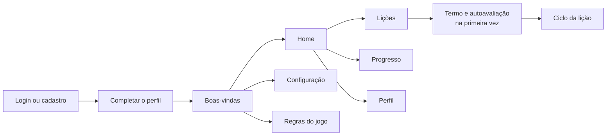
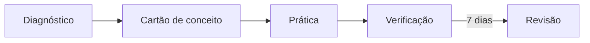
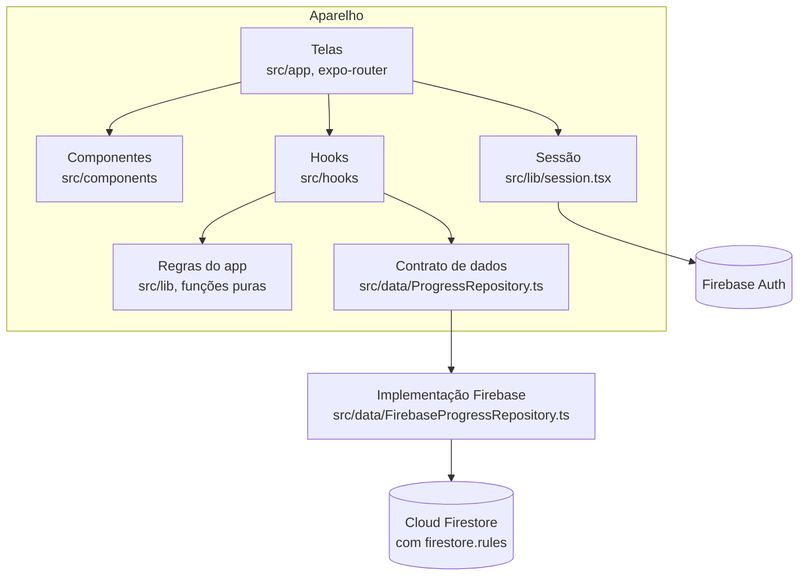

# Arquitetura do app Beast Maragames

App mobile de estudo de criação de jogos, feito para a Beast Maragames na disciplina de Programação Mobile (UNDB). O aluno percorre lições organizadas em módulos e, a cada questão, diz o quanto tem certeza da resposta. O app usa essa confiança declarada para mostrar o que a pessoa sabe de fato e o que só acha que sabe.

Por enquanto, só o módulo **Fundamentos de Game Design** tem questões, com 5 lições: O que é Game Design, Framework MDA, Core Loop e Diversão, Balanceamento de Jogo e Level Design. Os outros 5 módulos (Game Engines, Programação para Jogos, Arte & Pixel Art, Áudio & Música e Publicação & Monetização) aparecem na lista de lições como "em breve", só com os títulos das lições, a partir de `content/em-breve.json`.

## O que o aluno faz

A boas-vindas é a primeira tela de quem já entrou, em `/`: o nome do app, o botão Iniciar, a Configuração (só a escolha do tema, a mesma do Perfil) e as Regras do jogo. O Iniciar troca a boas-vindas pela home, que fica em `/home`. A home mostra o cartão "Para hoje", com o próximo passo sugerido, o XP, a sequência de dias e as revisões agendadas. O Perfil reúne os dados do cadastro, as perguntas de "Sobre você", o tema claro ou escuro, o termo aceito e a saída da conta.

## O ciclo de uma lição

- **Diagnóstico** e **verificação** medem o tópico antes e depois do estudo, com formas paralelas de questões (A e B), sem feedback por questão.
- **Prática** dá feedback a cada resposta.
- **Revisão** abre 7 dias depois da verificação e mede o quanto ficou.

No dado, as fases se chamam `pre`, `pratica`, `pos` e `reteste`.

## Confiança, quadrante e XP

Cada resposta leva a escolha e a confiança: 1 Palpite, 2 Tenho dúvida, 3 Tenho certeza. Só "Tenho certeza" conta como confiança alta. Acerto e confiança dão o quadrante:

| | Confiança alta | Confiança baixa |
|---|---|---|
| **Acertou** | Firme | Frágil |
| **Errou** | Ponto cego | Lacuna |

O XP segue a pontuação por certeza de Gardner-Medwin, com o erro adaptado para 4 alternativas: acerto vale 1, 2 ou 3; erro vale 0, −1 ou −4. Errar com certeza custa caro, e o palpite nunca perde ponto.

## Camadas

- **Telas e componentes** só mostram e coletam. Não calculam nada.
- **A sessão** cuida da conta (entrar, cadastrar, redefinir a senha, sair) e do perfil.
- **Hooks** buscam os dados pelo contrato e entregam às telas o resultado das funções de `src/lib`.
- **`src/lib`** tem as regras do app em funções puras: sem React, sem Firebase, sem estado. Recebem respostas e questões e devolvem o estado da lição, o domínio, os quadrantes, o XP, a sequência e a sugestão do dia. É a parte mais testada do projeto.
- **O contrato de dados** (`ProgressRepository`) é a única porta para o banco. As telas e os hooks enxergam só a interface, e os testes de tela usam uma versão em memória (`src/test/repositorio-falso.ts`).

## O princípio central: nada calculado é gravado

O banco guarda só fatos: o perfil, a autoavaliação, as tentativas e as respostas. Domínio, quadrante, XP, sequência e estado da lição são sempre recalculados a partir das respostas. Mudar uma regra em `src/lib` recalcula tudo, inclusive o passado, sem migrar dados.

## O que fica no Firestore

| Coleção | Um documento por | Quem lê e grava |
|---|---|---|
| `lessons` | lição (conteúdo) | qualquer pessoa logada lê; só o seed grava |
| `questions` | questão (conteúdo) | idem |
| `users` | pessoa | cada um lê e edita só o seu; os campos são validados na regra |
| `selfAssessments` | pessoa | gravada uma vez, sem edição |
| `attempts` | passo de lição feito | cada um lê e cria só as suas; só muda o andamento |
| `answers` | questão confirmada | cada um lê e cria só as suas; ninguém edita nem apaga |
| `piloto/contador` | (um só) | só anda junto com o aceite do termo |

As regras ficam em `firestore.rules` e são testadas no emulador do Firestore (`regras/`). O aceite do termo é uma transação que soma 1 ao contador e grava no perfil a forma do diagnóstico (A ou B, alternadas) e a data; a regra confere as duas pontas.

## O que há em `src/lib`

| Módulo | O que faz |
|---|---|
| `licao.ts` | O estado de cada lição (nova, diagnóstico, estudo, verificação, aguardando revisão, revisão, concluída) a partir das respostas |
| `sugestao.ts` | O passo único que a home sugere para hoje |
| `bloco.ts` | Quais questões entram em cada bloco e quais faltam responder |
| `pergunta.ts` | Regras da tela da questão: o que precisa estar marcado para confirmar e a resposta que a confirmação gera |
| `embaralhar.ts` | Ordem das alternativas por semente, igual em qualquer aparelho |
| `quadrante.ts` | Acerto × confiança |
| `xp.ts` | XP por resposta e por lição |
| `resultado.ts` | Resultado de um bloco: acertos, XP, quadrantes e o que revisar primeiro |
| `dominio.ts` | Taxa de acerto por tópico |
| `progresso.ts` | Os números da tela de Progresso |
| `sequencia.ts` | Dias de calendário seguidos com resposta |
| `calendario.ts` | O dia de calendário em fuso fixo (São Luís, UTC−3) |
| `participante.ts` | A forma do diagnóstico (A ou B), alternada pela ordem de aceite do termo |
| `perfil.ts` | Campos obrigatórios e listas de opções do perfil |
| `validacao.ts` | Validação de e-mail, senha, telefone e campos do perfil |

Os comentários do código citam itens (item 14, item 22...) do registro de decisões técnicas do grupo, que entra numa entrega futura.

## Entregas

| Entrega | Data | O que entra |
|---|---|---|
| 1 | 16/10 | Login, cadastro, home, Perfil, Progresso e 4 lições de Fundamentos de Game Design |
| 2 | 06/11 | As 5 lições de Fundamentos de Game Design, os outros módulos em breve e, no Perfil, o estado em lista e sem instituição e curso |
| 3 | 14/11 | Simulação de turma, exportação, análise estatística e relatório |
| 4 | 27/11 | Documentação final |
